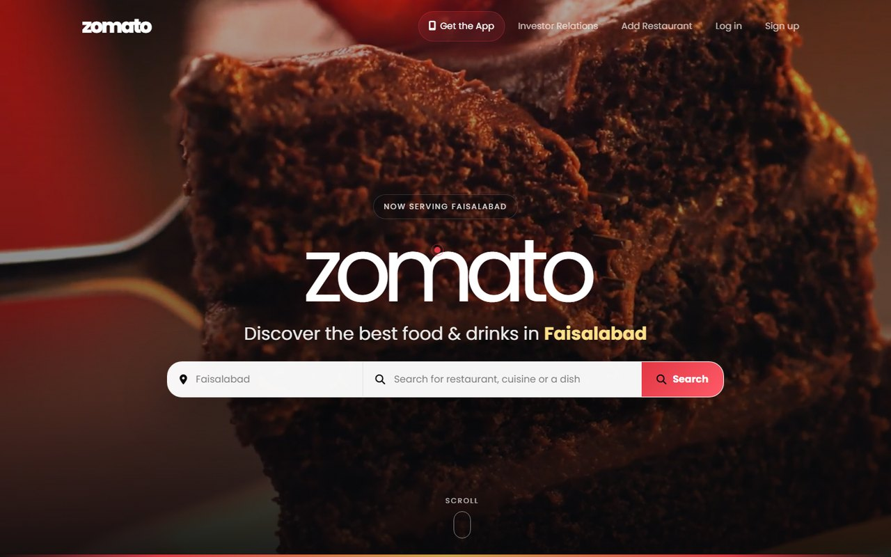

# Zomato Pakistan: Faisalabad landing page (practice project)

🔗 **Live:** https://zomato-pakistan.vercel.app



A practice project: a food-delivery landing page for Faisalabad. I first built it as a static HTML/CSS/JavaScript page, then rebuilt it in React and Tailwind CSS.

> This is a learning project and is not affiliated with Zomato. The brand name is used only to describe the design reference.

## Tech stack

React 19 · Vite 7 · Tailwind CSS v4

The original static version is kept in [`legacy-static/`](legacy-static/) for comparison.

## Run locally

```bash
npm install
npm run dev       # http://localhost:5173
npm run build     # production build in dist/
npm run preview   # serve the build
```

## Structure

```
src/
  App.jsx               Page sections
  useZomatoEffects.js   Scroll and interaction effects
  index.css             Tailwind entry
legacy-static/          The first, plain HTML/CSS/JS version
```
